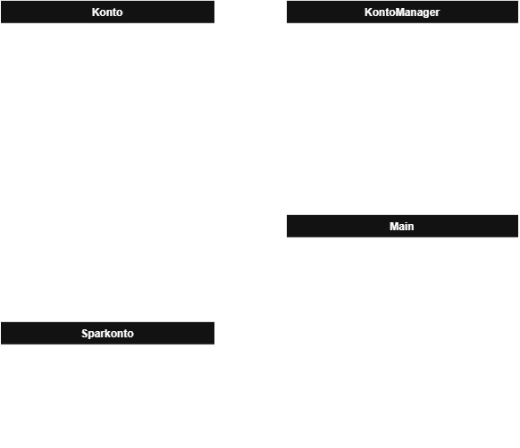

# BONTO

Bonto (Bankkonto) soll zeigen wie ein Softwareprojekt mit und ohne OOP (Objekt Orientierter Programmierung) aussehen kann. Zudem soll aus dem Projekt ein Minecraft Plugin entstehen, in welchem die Grundlegenden Java und Paper Konzepte erlernt werden.

## Ziel sind 3 Projekte

- `BONTO als Skript` (keine Klassen, alles in der Main-Datei, kein Polymorphismus)
- `BONTO mit OOP` (aufteilen der Kontotypen in Klassen, ein Kontomanager, Polymorphisumus)
- `BONTO Plugin` (hier wird das Projekt aus `Bonto mit OOP` importiert und zum Plugin weiterverarbeitet)

# BONTO als Skript

Bonto als Skript soll der veranschaulichung von einer überfüllten Codedatei dienen. Man soll merken das das auslagern von Code sehr nütlich sein kann.

## Anforderungen

- Das Programm soll eine Listen an Integer Arrays erstellen
  - Die erste Stelle des Arrays ist die ID
  - Die zweite Stelle ist der aktuelle Betrag im Konto
    > Beispiel:  
    > `[ 82746, 0 ]`

- Das Programm soll dem Nutzer die möglichkeit geben ein Konto auszuwählen

  > Beispiel:
  >
  > ```bat
  > Wähle ein Konto das du bearbeiten möchtest:
  > 0. '45124': 0€
  > 1. '92856': 0€
  > ```

- Nach auswahl des Kontos soll der Nutzer gefragt werden ob er einzahlen oder auszahlen möchte

  > Beispiel:
  >
  > ```bat
  > Mächtest du einzahlen oder auszahlen? (e/a)
  > ```

- Nach auswahl ob man einzahlen oder auszahlen möchte, soll man einen Betrag eingeben können

  > Beispiel:
  >
  > ```bat
  > Wie viel möchtest du einzahlen?
  > ```

- Der User soll anschließend gefragt werden ob er das Programm beenden möchte

  > Beispiel:
  >
  > ```bat
  > Möchtest du das Menü verlassen? (y/n)
  > ```

- Möchte er es nicht beenden startet der Prozess von vorn. Möchte er es beenden bricht das Programm ab

## Nützliche Klassen

<details>
  <summary>Klicken zum Öffnen</summary>

  <ul>
    <li>ArrayList</li>
    <li>Scanner oder JOptionPane</li>
  </ul>

</details>

# BONTO mit OOP

Mit BONTO OOP sollen Grundlegende Prinzipien der Objektorientierung näher gebracht werden.

## Anforderungen

Grundlegende Anforderungen sind die selben wie in `BONTO als Skript`. Nun sollen allerdings Klassen dazukommen.

- Benötigte Klassen:
  - Konto (Basisklasse aller Kontoarten)
  - Sparkonto (Kontovariante)
  - Kontomanager (Managet die HashMap von Konten)



# BONTO als Plugin

BONTO als Plugin soll Grundlegende Funktionen von Paper Plugins näherbringen.

## Anforderungen

BONTO mit OOP kann in das Plugin einfach übernommen werden.  
Die Ausgabe in der Konsole soll nun lediglich durch eine Chatausgabe oder eine ChestGUI ersetzt werden.
